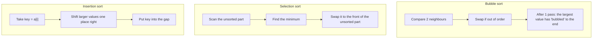

## Run it line by line

Pick an algorithm with the tabs, then press **Play** or use the ← → keys to go step by step. You can enter your own array, or try the *Already sorted* and *Reversed* presets to see the best and worst cases.

```embed
src: visualizer.html
title: Sort visualizer (bubble · selection · insertion)
height: 1060
```

## The idea behind each algorithm



## Comparison

| | Bubble | Selection | Insertion |
|---|---|---|---|
| Best case | O(n) thanks to early exit | O(n²) | O(n) |
| Average / worst case | O(n²) | O(n²) | O(n²) |
| Swaps or writes | Up to O(n²) swaps | **At most n − 1 swaps** | O(n²) shifts |
| Stable | Yes | No | Yes |
| Strength | Easy to understand, knows when it is done | Fewest memory writes | Very fast on nearly sorted arrays |

> [!TIP]
> Insertion sort is what the "serious" algorithms use for small arrays: TimSort (Python, Java) and introsort (C++ `std::sort`) both switch to insertion sort when the remaining range is short.

## Review

<details>
<summary>Why is bubble sort's best case O(n) but selection sort's is not?</summary>

Bubble sort has the `tmp` flag: if a pass makes no swaps, the array is already sorted and it stops. Selection sort always has to scan the whole unsorted part to be sure it found the minimum.
</details>

<details>
<summary>Why is selection sort not stable?</summary>

The swap that moves the minimum to the front can jump over an equal value. For example, with `[2a, 2b, 1]`: swapping `1` with `2a` gives `[1, 2b, 2a]`, so the two 2s change order.
</details>

<details>
<summary>How is a "shift" in insertion sort different from a "swap"?</summary>

`key` is saved outside the array once. Each step just copies `a[j]` into `a[j+1]` (1 write instead of the 3 a swap needs), and at the end `key` is written into the gap.
</details>
