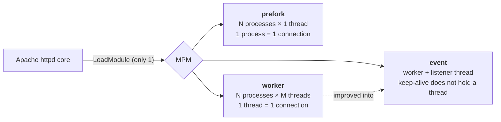

## Summary

An **MPM (Multi-Processing Module)** decides *how Apache handles concurrent requests*: how many processes, how many threads, and who accepts connections.

- There are 3 main MPMs on Linux: **prefork**, **worker**, **event**.
- Apache loads **exactly one MPM** at a time.
- MPMs are loaded as modules (`LoadModule`), so switching only needs a config change and a restart, not a recompile.



> [!IMPORTANT]
> The original notes say "prefork is the default". That was true for **Apache 2.2**. Since **Apache 2.4**, the default on common Linux distributions (Ubuntu/Debian, RHEL 8+) is **event**. You still see prefork often, because `mod_php` is not thread-safe and requires it.
> Also, `MaxClients` was renamed **`MaxRequestWorkers`** in 2.4 (the old name still works).

## 1. Prefork: many processes, one connection each

No threads. One **parent process** (running as root) only manages the pool: it forks and kills child processes. It does **not** handle requests. The **child processes** (running as a normal user like `www-data`) call `accept()` on the listen socket themselves, and each child handles **one connection at a time**.

"Pre-fork" means forking **ahead of time**: Apache keeps a few idle processes ready, so clients never wait for a fork.

```flow
title: Prefork — requests going through the pool of child processes
hidden: [cE, ch4]
nodes:
  - { id: cA, label: Client A, kind: client, col: 0, row: 0 }
  - { id: cB, label: Client B, kind: client, col: 0, row: 1 }
  - { id: cC, label: Client C, kind: client, col: 0, row: 2 }
  - { id: cD, label: Client D, kind: client, col: 0, row: 3 }
  - { id: cE, label: Client E, kind: client, col: 0, row: 4 }
  - { id: sock, label: "Listen socket :80", sub: backlog queue, kind: socket, col: 1.3, row: 2 }
  - { id: ch1, label: Child process 1, kind: process, col: 2.6, row: 0.5 }
  - { id: ch2, label: Child process 2, kind: process, col: 2.6, row: 1.5 }
  - { id: ch3, label: Child process 3, kind: process, col: 2.6, row: 2.5 }
  - { id: ch4, label: Child process 4, kind: process, col: 2.6, row: 3.5 }
  - { id: parent, label: Parent process, sub: "root · manages only", kind: server, col: 4, row: 2 }
groups:
  - { label: "Child process pool (MaxRequestWorkers = 4)", nodes: [ch1, ch2, ch3, ch4] }
edges:
  - cA -> sock
  - cB -> sock
  - cC -> sock
  - cD -> sock
  - cE -> sock
  - sock -> ch1
  - sock -> ch2
  - sock -> ch3
  - sock -> ch4
  - { from: parent, to: ch1, dashed: true }
  - { from: parent, to: ch2, dashed: true }
  - { from: parent, to: ch3, dashed: true }
  - { from: parent, to: ch4, dashed: true }
steps:
  - title: Startup
    text: >-
      The parent opens port 80 and forks StartServers = 3 child processes ahead of time.
      All three are free and waiting on accept() on the same listen socket.
    flow: [parent -> ch1, parent -> ch2, parent -> ch3]
    state: { ch1: idle, ch2: idle, ch3: idle }
    labels: { ch1: free, ch2: free, ch3: free }
  - title: Request A arrives
    text: >-
      The kernel puts A's connection in the listen socket's queue. A free child calls accept()
      and takes it. The parent never touches the request.
    flow: [cA -> sock, sock -> ch1]
    state: { ch1: busy, cA: busy }
    labels: { ch1: handling A }
  - title: B and C arrive
    text: >-
      Each connection takes a whole process. Now all 3 processes are busy and none are free.
    flow: [cB -> sock, sock -> ch2, cC -> sock, sock -> ch3]
    state: { ch2: busy, ch3: busy, cB: busy, cC: busy }
    labels: { ch2: handling B, ch3: handling C }
  - title: Too few free processes, so fork one more
    text: >-
      The number of free processes is below MinSpareServers, so the parent forks child 4.
      Forking takes time, which is why Apache does it before a request needs it.
    show: [ch4]
    flow: [parent -> ch4]
    state: { ch4: idle }
    labels: { ch4: free (just forked) }
  - title: D arrives, the pool is full
    text: >-
      Child 4 takes D. Now 4 of 4 processes are busy, which equals MaxRequestWorkers.
      Apache is not allowed to fork any more.
    flow: [cD -> sock, sock -> ch4]
    state: { ch4: busy, cD: busy }
    labels: { ch4: handling D }
  - title: E has to wait
    text: >-
      E connects, but no process is free to accept() it. The connection waits in the socket's backlog.
      If it waits too long or the backlog fills up, the client times out or is refused.
    show: [cE]
    flow: [cE -> sock]
    state: { cE: wait, sock: wait }
    labels: { sock: "1 connection waiting" }
  - title: A finishes, child 1 takes E
    text: >-
      When A's connection closes (including keep-alive time), child 1 is free again and accepts E.
      The number of concurrent requests can never be higher than the number of processes.
    flow: [sock -> ch1]
    state: { cA: done, cE: busy, sock: normal, ch1: busy }
    labels: { ch1: handling E, sock: null }
  - title: The cost
    text: >-
      Every process has its own memory, usually a few MB to a few tens of MB depending on modules (mod_php is heavy).
      4 processes are fine, but 1000 connections need 1000 processes, which costs a lot of RAM and context switching.
      The upside: if one process crashes, only one request is affected.
    active: [ch1, ch2, ch3, ch4]
```

**Consequences:**

- The number of concurrent requests is capped by `MaxRequestWorkers` (formerly `MaxClients`). Above that, requests wait or are refused.
- RAM grows with the number of connections, because each connection is a process.

## 2. Worker: many processes, many threads each

Worker still creates several child processes, but each process creates many **threads**, and **each thread handles one connection**. Threads share their process's memory, so worker serves more connections with less RAM than prefork.

```flow
title: Worker — a keep-alive connection holds a thread
hidden: [cD, cE]
nodes:
  - { id: cA, label: Client A, kind: client, col: 0, row: 0 }
  - { id: cB, label: Client B, kind: client, col: 0, row: 1 }
  - { id: cC, label: Client C, kind: client, col: 0, row: 2 }
  - { id: cD, label: Client D, kind: client, col: 0, row: 3 }
  - { id: cE, label: Client E, kind: client, col: 0, row: 4 }
  - { id: sock, label: "Listen socket :80", kind: socket, col: 1.3, row: 2 }
  - { id: t1, label: Thread 1, kind: thread, col: 2.6, row: 0.4 }
  - { id: t2, label: Thread 2, kind: thread, col: 2.6, row: 1.4 }
  - { id: t3, label: Thread 3, kind: thread, col: 2.6, row: 2.75 }
  - { id: t4, label: Thread 4, kind: thread, col: 2.6, row: 3.75 }
groups:
  - { label: Child process 1 (shared RAM), nodes: [t1, t2] }
  - { label: Child process 2 (shared RAM), nodes: [t3, t4] }
edges:
  - cA -> sock
  - cB -> sock
  - cC -> sock
  - cD -> sock
  - cE -> sock
  - sock -> t1
  - sock -> t2
  - sock -> t3
  - sock -> t4
steps:
  - title: Startup
    text: >-
      2 child processes with 2 threads each (the real default ThreadsPerChild is 25).
      4 threads in total, so at most 4 concurrent connections.
    state: { t1: idle, t2: idle, t3: idle, t4: idle }
    labels: { t1: free, t2: free, t3: free, t4: free }
  - title: A, B, C arrive
    text: >-
      Each connection goes to a free thread. Three threads are busy, but they only cost the RAM of two processes.
    flow: [cA -> sock, sock -> t1, cB -> sock, sock -> t2, cC -> sock, sock -> t3]
    state: { t1: busy, t2: busy, t3: busy, cA: busy, cB: busy, cC: busy }
    labels: { t1: handling A, t2: handling B, t3: handling C }
  - title: A gets its response but keeps the connection open
    text: >-
      The browser uses keep-alive: after the response, the connection stays open for reuse.
      A is silent, but thread 1 is still tied to that connection and sits waiting, doing nothing.
    state: { cA: held, t1: held }
    labels: { cA: keep-alive (silent), t1: "holding A, idle" }
  - title: D arrives
    text: Thread 4 is the last free thread, and it takes D.
    show: [cD]
    flow: [cD -> sock, sock -> t4]
    state: { t4: busy, cD: busy }
    labels: { t4: handling D }
  - title: E waits, even though thread 1 does nothing
    text: >-
      All 4 threads are taken, so E waits in the backlog. Thread 1 is only holding an idle connection.
      This is worker's weakness: idle keep-alive connections still occupy threads.
    show: [cE]
    flow: [cE -> sock]
    state: { cE: wait, sock: wait }
    active: [t1]
```

> [!NOTE]
> The diagram is simplified: in the real worker MPM, each child process has a listener thread that accepts connections and hands them to worker threads. The key point is the same: one connection holds one thread until it closes.

## 3. Event: worker plus a listener for idle connections

Event builds on worker but fixes exactly the keep-alive problem. Each process has a **listener thread** that uses `epoll` to watch many idle connections at once. After sending a response, a worker thread **hands the connection back to the listener** and is free for other work. When an idle connection actually sends a new request, the listener passes it to a free worker thread.

```flow
title: Event — the listener holds idle connections, threads are freed
nodes:
  - { id: cA, label: Client A, kind: client, col: 0, row: 0.5 }
  - { id: cB, label: Client B, kind: client, col: 0, row: 1.5 }
  - { id: cC, label: Client C, kind: client, col: 0, row: 2.5 }
  - { id: sock, label: "Listen socket :80", kind: socket, col: 1.3, row: 1.5 }
  - { id: listener, label: Listener thread, sub: accept + epoll, kind: thread, col: 2.6, row: 0.4 }
  - { id: t1, label: Worker thread 1, kind: thread, col: 2.6, row: 1.5 }
  - { id: t2, label: Worker thread 2, kind: thread, col: 2.6, row: 2.5 }
groups:
  - { label: Child process, nodes: [listener, t1, t2] }
edges:
  - cA -> sock
  - cB -> sock
  - cC -> sock
  - sock -> listener
  - listener -> t1
  - listener -> t2
steps:
  - title: Startup
    text: >-
      One child process with 1 listener thread and 2 worker threads. The listener is the only thread
      that accepts new connections and watches idle ones.
    state: { t1: idle, t2: idle }
    labels: { t1: free, t2: free }
  - title: A arrives
    text: The listener calls accept() for A, then hands the connection to worker thread 1.
    flow: [cA -> sock, sock -> listener, listener -> t1]
    state: { cA: busy, t1: busy }
    labels: { t1: handling A }
  - title: B arrives
    text: The same happens for B, which goes to worker thread 2. Now both workers are busy.
    flow: [cB -> sock, sock -> listener, listener -> t2]
    state: { cB: busy, t2: busy }
    labels: { t2: handling B }
  - title: A gets its response, the connection goes back to the listener
    text: >-
      This is the difference from worker. A still keeps its keep-alive connection, but thread 1 hands it
      back to the listener and is free right away. The listener can watch many idle connections at almost no cost.
    flow: [t1 -> listener]
    state: { cA: held, t1: idle, listener: held }
    labels: { cA: keep-alive (silent), t1: free, listener: "holding: A" }
  - title: C arrives and gets a thread immediately
    text: >-
      C goes to thread 1. With worker, C would have to wait, because thread 1 would still be held by A.
    flow: [cC -> sock, sock -> listener, listener -> t1]
    state: { cC: busy, t1: busy }
    labels: { t1: handling C }
  - title: B finishes and closes
    text: B does not use keep-alive, so its connection closes completely. Thread 2 is free.
    state: { cB: done, t2: idle }
    labels: { t2: free }
  - title: A sends a second request
    text: >-
      epoll tells the listener that A's connection has new data. The listener hands it to a free thread,
      thread 2. A thread is only occupied when there is real work to do.
    flow: [cA -> listener, listener -> t2]
    state: { cA: busy, listener: normal, t2: busy }
    labels: { cA: null, listener: null, t2: "handling A (2nd request)" }
```

## Comparison

| | prefork | worker | event |
|---|---|---|---|
| What handles 1 connection | 1 process | 1 thread | 1 thread, **only while a request is active** |
| RAM | High (each process has its own memory) | Lower (threads share memory) | Lowest |
| Idle keep-alive connection | Holds a whole process | Holds a thread | Held by the listener, thread is freed |
| Fault isolation | Good: a crash affects 1 request | A crashing thread can take down its process | Same as worker |
| Thread safety | Not required | Modules must be thread-safe | Modules must be thread-safe |
| When to use | `mod_php` or non-thread-safe modules | Rarely, event is better | The current default, together with PHP-FPM |

## Configuration

Switching MPM (Debian/Ubuntu):

```bash
apachectl -V | grep -i mpm          # which MPM is in use
sudo a2dismod mpm_prefork
sudo a2enmod mpm_event
sudo systemctl restart apache2      # switching MPM needs a full restart
```

Main prefork settings (`mpm_prefork.conf`):

```apache
<IfModule mpm_prefork_module>
    StartServers             5     # processes forked at startup
    MinSpareServers          5     # fewer free processes than this: fork more
    MaxSpareServers         10     # more free processes than this: kill some
    MaxRequestWorkers      150     # max concurrent connections (formerly MaxClients)
    MaxConnectionsPerChild   0     # >0: recycle a process after N connections, avoids memory leaks
</IfModule>
```

> [!TIP]
> To estimate `MaxRequestWorkers` for prefork: **RAM available to Apache / RAM per child process**.
> Example: a 4 GB machine, keep 1 GB for the OS and database, each process uses about 50 MB (check with `ps -ylC apache2 --sort:rss`): 3000 / 50 ≈ **60**.
> Set it higher and the machine starts swapping under load, which slows every request down.

## Review

<details>
<summary>Does the parent process in prefork handle requests?</summary>

No. It only forks and kills child processes to keep enough of them free. The children call `accept()` on the listen socket themselves.
</details>

<details>
<summary>Why is it called "pre-fork"?</summary>

Because processes are forked **before** requests arrive. Forking takes time, so keeping free processes ready means clients never wait for it.
</details>

<details>
<summary>Prefork has 150 processes. What happens to request 151?</summary>

It waits in the listen socket's backlog until a process is free. If it waits too long or the backlog is full, the client times out or is refused.
</details>

<details>
<summary>What is worker's main weakness that event fixes?</summary>

An idle keep-alive connection still holds a thread. In event, a listener thread watches those connections, so worker threads are only occupied while there is an actual request.
</details>

<details>
<summary>When do you still have to use prefork?</summary>

When using a module that is not thread-safe, typically `mod_php`. The modern approach is to use event and run PHP through PHP-FPM.
</details>

<details>
<summary>Does switching MPM require recompiling Apache?</summary>

No, as long as the MPM is built as a module (DSO). Just change `LoadModule` or use `a2enmod`/`a2dismod`, then restart.
</details>
