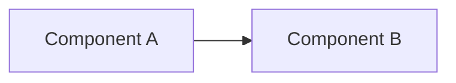

## Summary

- Key idea 1
- Key idea 2



## How it works, step by step

```flow
title: Request through the system
nodes:
  - { id: client, label: Client, kind: client, col: 0, row: 0 }
  - { id: server, label: Server, kind: server, col: 2, row: 0 }
edges:
  - client -> server
steps:
  - title: Request
    text: The client sends a request.
    flow: [client -> server]
    state: { server: busy }
```

## Review

<details>
<summary>Question?</summary>

Answer.
</details>
